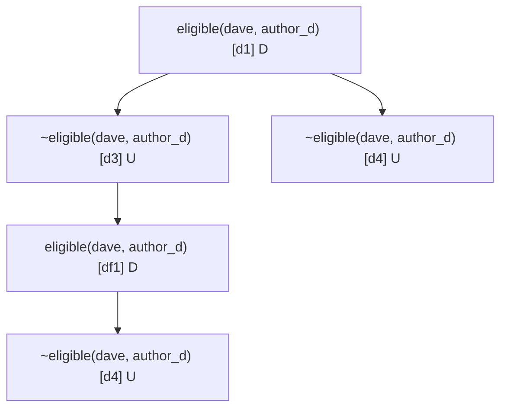

# Gunray

*(named for Donald Nute, by way of Nute Gunray)*

A pure-Python engine for defeasible reasoning, stratified Datalog, and
propositional default closure. Give it rules that conflict and it works out
which conclusions survive — then lets you inspect the argument-and-defeater
chain behind the result. MIT licensed; Python 3.11+.

Use Gunray when a plain true/false result is not enough: policy exceptions,
conflicting evidence, defaults with explicit overrides, or Datalog rules that
need a traceable result. It keeps unresolved conflicts visible rather than
silently choosing a winner.

```python
from gunray import DefeasibleTheory, GunrayEvaluator, MarkingPolicy, Rule

theory = DefeasibleTheory(
    facts={"bird": {("tweety",), ("opus",)}, "penguin": {("opus",)}},
    strict_rules=[Rule(id="s1", head="bird(X)", body=["penguin(X)"])],
    defeasible_rules=[
        Rule(id="r1", head="flies(X)",  body=["bird(X)"]),
        Rule(id="r2", head="~flies(X)", body=["penguin(X)"]),
    ],
)

model = GunrayEvaluator().evaluate(theory, marking_policy=MarkingPolicy.BLOCKING)
# `model.sections` records the four-valued result for each ground literal.
```

`~flies(X) :- penguin(X)` is a *defeasible* rule, not a strict one. It is
strong enough to defeat `flies(X) :- bird(X)` for the penguin case without
changing the strict conclusion that penguins are birds.

## `UNDECIDED` is a first-class answer

Sometimes the evidence genuinely does not resolve. Nixon was a Quaker
*and* a Republican; one defeasible rule says Quakers are pacifists,
another says Republicans aren't. Neither argument out-specifies the
other — so Gunray returns `Answer.UNDECIDED` rather than inventing a
winner.

```python
from gunray import (
    Answer, DefeasibleTheory, GeneralizedSpecificity, Rule, answer,
)
from gunray.types import GroundAtom

theory = DefeasibleTheory(
    facts={"republican": {("nixon",)}, "quaker": {("nixon",)}},
    defeasible_rules=[
        Rule(id="r1", head="~pacifist(X)", body=["republican(X)"]),
        Rule(id="r2", head="pacifist(X)",  body=["quaker(X)"]),
    ],
)

pacifist_nixon = GroundAtom(predicate="pacifist", arguments=("nixon",))
criterion      = GeneralizedSpecificity(theory)

assert answer(theory, pacifist_nixon, criterion) is Answer.UNDECIDED
```

`Answer` has four values: `YES` (the literal is warranted),
`NO` (its complement is warranted), `UNDECIDED` (arguments exist on
both sides and neither wins), `UNKNOWN` (the predicate is not in the
language of the theory). This is García & Simari 2004 Def 5.3.

## Install

Add it to an existing `uv` project:

```bash
uv add git+https://github.com/ctoth/gunray.git
```

For development:

```bash
git clone https://github.com/ctoth/gunray.git
cd gunray
uv sync --extra dev
```

## CLI and REPL

`gunray run` evaluates a plain Datalog program written in YAML or JSON. Save
this program as `ancestry.gnr`:

```yaml
facts:
  parent: [[leaf, branch], [branch, root]]
rules:
  - 'above(X,Y) :- parent(X,Y).'
  - 'above(X,Z) :- parent(X,Y), above(Y,Z).'
  - 'answer(X) :- above("leaf",X).'
```

`gunray run ancestry.gnr --query answer` prints `{"answer":[["branch"],["root"]]}`.
Omit `--query` to return the model. To add facts for a particular run,
pass `--facts more.yaml` with a mapping such as `parent: [[root, sky]]`.
From Python, `evaluate_program_file("ancestry.gnr", facts={"parent": [("root", "sky")]},
query="answer").facts` returns the relation as a set of tuples. Import the
function from `gunray`. Additional rows apply only to that evaluation.

In YAML fact rows, `leaf` is a string. In rule terms, `leaf` and `X` are
both variables. Write `"leaf"` for the literal string. Rule parsing and
safety errors identify the file and the starting line of the rule.

To inspect how a Datalog result was derived, capture derivations explicitly:

```python
from gunray import GroundAtom, TraceConfig, evaluate_program_file_with_trace

_, trace = evaluate_program_file_with_trace(
    "ancestry.gnr", query="answer", trace_config=TraceConfig(capture_derivations=True)
)
step = trace.derivation_for(GroundAtom("answer", ("root",)))
assert step is not None
print(step.rule_text)  # answer(X) :- above("leaf",X).
print(step.premises)   # (GroundAtom(predicate='above', arguments=('leaf', 'root')),)
```

Call `derivation_for` on any premise to follow the derivation back to
supplied facts. Each step records one successful rule application, with
the matched premises in rule order and the instantiated comparisons and
negated patterns that held. For a supplied fact, the step's `rule_text`
is `None`. An absent tuple returns `None`; asking a trace that has no
derivations raises `ValueError`. The same trace option works with
`GunrayEvaluator.evaluate_with_trace`. It records the first successful
application, which can depend on evaluation order.

See Zhao, Subotić, and Scholz, [*Debugging Large-scale Datalog*, Def. 2.1
and §3.3, pp. 7:7 and 7:16–17](https://doi.org/10.1145/3379446).

The `answer`, `model`, `explain` and `tree` commands accept the existing
`DefeasibleTheory` schema in YAML or JSON.

For example, save this as `theory.yaml`:

```yaml
facts:
  bird:
    - [tweety]
  penguin:
    - [opus]
defeasible_rules:
  - id: r1
    head: flies(X)
    body: [bird(X)]
  - id: r2
    head: ~flies(X)
    body: [penguin(X)]
```

```bash
uv run gunray answer theory.yaml 'flies("tweety")'
uv run gunray explain theory.yaml 'flies("tweety")'
uv run gunray tree theory.yaml 'flies("tweety")' --format text
uv run gunray model theory.yaml --format json
```

String constants in CLI queries must be quoted; `flies(opus)` is rejected,
while `flies("opus")` is valid. Pass `--input-format json` when a JSON input
does not use a `.json` filename.

The default tree format is indented text. Use `--format unicode` for the
box-drawing renderer, `--format mermaid` for a flowchart, or `--format json`
for structured output. Pass `-` instead of a file path to read a theory from
standard input.

Start the interactive shell with `uv run python -m gunray`. It can load and save
YAML/JSON theories, inspect schema sections, answer queries, render
explanations and trees, and incrementally add or remove schema-backed rules.

## Three evaluators, one dispatcher

`GunrayEvaluator.evaluate` dispatches on the input type.

- **`DefeasibleTheory`** → the DeLP pipeline: arguments, dialectical
  trees, Procedure 5.1 marking, four-valued answers. The main event.
- **`Program`** → stratified Datalog with Apt-Blair-Walker safety and a
  choice of negation semantics (see below).
- **Propositional defaults** → KLM rational / lexicographic / relevant
  closure via `gunray.closure.ClosureEvaluator`.

```python
from gunray import GunrayEvaluator, Program

model = GunrayEvaluator().evaluate(Program(
    facts={"edge": {("a", "b"), ("b", "c")}},
    rules=[
        "path(X, Y) :- edge(X, Y).",
        "path(X, Z) :- edge(X, Y), path(Y, Z).",
    ],
))
# model.facts["path"] == {("a", "b"), ("b", "c"), ("a", "c")}
```

`DefeasibleEvaluator`, `SemiNaiveEvaluator`, and `ClosureEvaluator` are
exported directly if you'd rather skip the dispatcher.

## Compare marking policies

Use `GunrayEvaluator.compare_marking_policies` to see how the answer to a
ground query changes across selected marking policies on the same theory.

```python
from gunray import GroundAtom, GunrayEvaluator, MarkingPolicy

support = GunrayEvaluator().compare_marking_policies(
    theory,
    GroundAtom("q", ()),
    policies=(MarkingPolicy.ANTONIOU_BLOCKING, MarkingPolicy.ANTONIOU_PROPAGATING),
)
```

Each key is an observed `Answer`. Its value is the set of selected policies
that returned it. One key means the selected policies agree. As with the
CLI, a literal omitted from a policy's model counts as `Answer.UNKNOWN`.
The selection must contain at least one policy. Each distinct policy runs
once, and evaluation errors propagate to the caller.

In the [Antoniou example](tests/test_antoniou_ambiguity_policy.py), `q`
has support for `YES` under ambiguity blocking and for `UNDECIDED` under
ambiguity propagation. Support here follows [Hellerstein 2026, Definition
3.2, p. 6](https://arxiv.org/pdf/2606.10270v1#page=6).

## Explanations — why did the engine decide that?

What was concluded is usually less interesting than why. For any
conclusion, Gunray gives you the dialectical tree, a marking, and a
prose transcript of the argument-and-defeater chain. Using the Tweety
theory from the opening example:

```python
from gunray import (
    GeneralizedSpecificity, build_arguments, build_tree,
    explain, mark, render_tree,
)
from gunray.types import GroundAtom

flies_opus = GroundAtom(predicate="flies", arguments=("opus",))
criterion  = GeneralizedSpecificity(theory)

for arg in build_arguments(theory):
    if arg.conclusion == flies_opus and arg.rules:
        tree = build_tree(arg, criterion, theory)
        print(render_tree(tree))          # Unicode tree diagram
        print(mark(tree))                 # "U" (warranted) or "D" (defeated)
        print(explain(tree, criterion))   # prose transcript
        break
```

```
flies(opus)  [r1]  (D)
└─ ~flies(opus)  [r2]  (U)
D
flies(opus) is NO.
An argument supports flies(opus) from {bird(opus)} via r1.
It is defeated by an argument for ~flies(opus) from {penguin(opus)} via r2, which is strictly more specific.
```

Trees also render to Mermaid via `render_tree_mermaid`. Here is the
peer-review conflict-of-interest case from
[`examples/reviewer_assignment.py`](examples/reviewer_assignment.py) —
a disqualification waiver (`df1`) is specific enough to lift
institutional COI (`d3`), but an explicit superiority pair keeps
advisor COI (`d4`) above the waiver:



The `[d1] D` / `[d3] U` markings are the Procedure 5.1 verdicts at each
node. The tree is how a contested conclusion becomes legible when the
answer disagrees with your intuition.

For the full `evaluate_with_trace` API — stratum-by-stratum rule-fire
logs for Datalog, `tree_for` / `marking_for` /
`arguments_for_conclusion` lookups for defeasible theories — see
[`ARCHITECTURE.md`](ARCHITECTURE.md).

## `SAFE` vs `NEMO` — negation semantics

Rules with variables in negated body literals have two competing
readings in the literature. Gunray ships both.

- `NegationSemantics.SAFE` (default) — Apt, Blair & Walker 1988
  stratified-Datalog safety. Every variable in a negated body literal
  must be bound by a positive body literal. Unsafe programs raise
  `SafetyViolationError`.
- `NegationSemantics.NEMO` — Ivliev et al. 2024 (KR 2024,
  [doi:10.24963/kr.2024/70](https://doi.org/10.24963/kr.2024/70)):
  variables in negated literals are interpreted existentially over the
  active Herbrand universe. Used by the conformance suite's Nemo
  fixtures.

Same theory, different answers. See
[`examples/safe_vs_nemo.py`](examples/safe_vs_nemo.py).

## Tests

```bash
uv run pytest tests -q
uv run pytest tests/test_conformance.py \
  --datalog-evaluator=gunray.conformance_adapter.GunrayConformanceEvaluator -q
uv run pyright
uv run ruff check
uv run ruff format --check
```

The conformance suite is
[`ctoth/datalog-conformance-suite`](https://github.com/ctoth/datalog-conformance-suite).
A handful of fixtures are explicitly out-of-contract and marked skip —
see [`ARCHITECTURE.md`](ARCHITECTURE.md#out-of-contract) for the list
and the reasons.

## More

- [`examples/`](examples/) — the full catalogue. Showcase cases, domain
  depth (clinical, GDPR, data fusion, access control), engine breadth
  (Datalog, KLM closure, SAFE vs NEMO), and Mermaid visuals.
- [`ARCHITECTURE.md`](ARCHITECTURE.md) — module layout, DeLP pipeline
  internals, preference composition, strict-only fast path, pitfalls.
- [`CITATIONS.md`](CITATIONS.md) — the paper trail.
